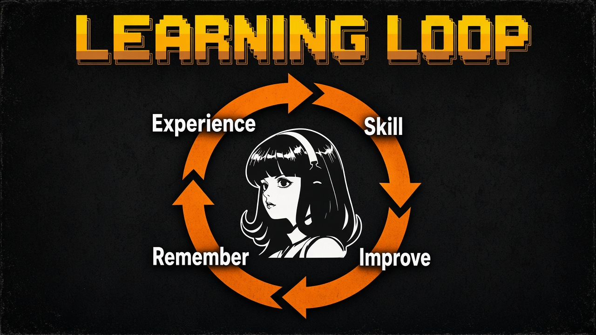
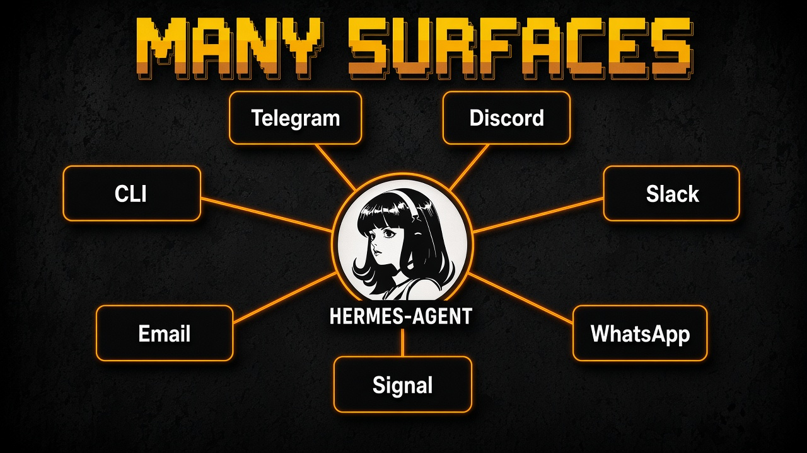
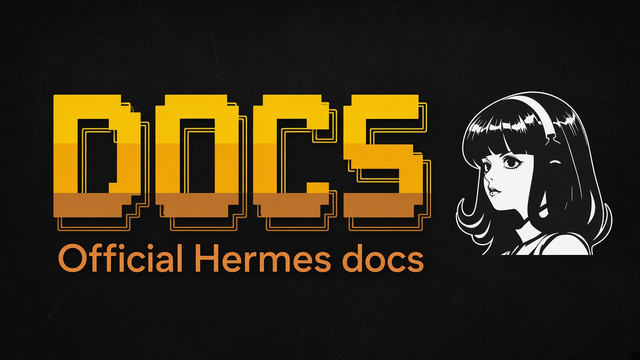
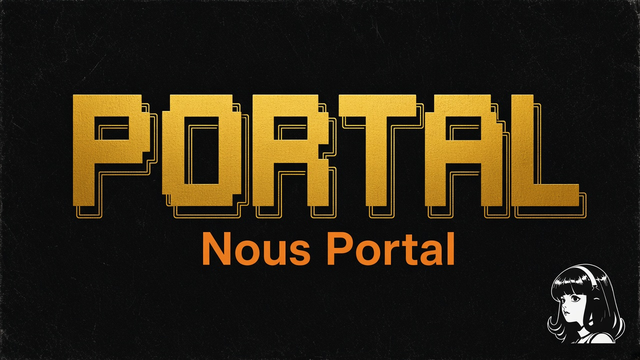

# Awesome Hermes Agent

<p align="center">
  
</p>

<p align="center">
  <a href="https://awesome.re"></a>
  <a href="https://github.com/NousResearch/hermes-agent"></a>
  
  
</p>

<p align="center">
  <strong>Beginner guides + curated links for <a href="https://github.com/NousResearch/hermes-agent">Hermes Agent</a></strong><br>
  Independent community list. Not an official Nous Research project.
</p>

---

## TL;DR

Hermes Agent (by [Nous Research](https://nousresearch.com)) is a self-improving open-source agent. It keeps memory, learns skills, chats on Telegram/Discord/Slack/WhatsApp/Signal/Email/CLI, runs cron jobs, supports MCP, and can live on a VPS or serverless sandbox.

- Site: [hermes-agent.nousresearch.com](https://hermes-agent.nousresearch.com/)
- Docs: [hermes-agent.nousresearch.com/docs](https://hermes-agent.nousresearch.com/docs/)
- Code: [NousResearch/hermes-agent](https://github.com/NousResearch/hermes-agent)

---

## Contents

- [Quick start](#quick-start)
- [Who is it for](#who-is-it-for)
- [Why it is useful](#why-it-is-useful)
- [Guides](#guides)
- [Official docs map](#official-docs-map)
- [Video tutorials](#video-tutorials)
- [Community](#community)
- [Official links](#official-links)
- [Popular ecosystem](#popular-ecosystem)
- [Community indexes](#community-indexes)
- [FAQ](#faq)
- [License](#license)

---

## Quick start

```bash
# macOS / Linux / WSL2
curl -fsSL https://hermes-agent.nousresearch.com/install.sh | bash
source ~/.bashrc   # or ~/.zshrc
hermes
hermes setup --portal   # or: hermes model
hermes doctor
```

```powershell
# Windows PowerShell (native)
iex (irm https://hermes-agent.nousresearch.com/install.ps1)
```

Or install [Hermes Desktop](https://hermes-agent.nousresearch.com/).

More detail: [docs/getting-started.md](docs/getting-started.md) · [docs/install.md](docs/install.md)

---

## Who is it for

| You want... | Start here |
|-------------|------------|
| First install | [Getting started](docs/getting-started.md) |
| Ordered learning | [Learning path](docs/learning-path.md) |
| Skills safely | [Skills](docs/skills.md) |
| Hosting / VPS | [Deployments](docs/deployments.md) |
| Migrate from OpenClaw etc. | [Comparisons](docs/comparisons.md) |
| Stay safe | [Security](docs/security.md) |

---

## Why it is useful

1. Skills learning loop ([docs](https://hermes-agent.nousresearch.com/docs/user-guide/features/skills))
2. Persistent memory ([docs](https://hermes-agent.nousresearch.com/docs/user-guide/features/memory))
3. Many chat surfaces ([site](https://hermes-agent.nousresearch.com/))
4. Cron + MCP + Tool Gateway
5. Import from OpenClaw / Claude Code / Codex / Cursor ([migrate](https://hermes-agent.nousresearch.com/docs/guides/migrate-from-openclaw))
6. MIT license, bring your own models

<p align="center">
  
</p>

<p align="center">
  
</p>

---

## Guides

| Guide | Topic |
|-------|-------|
| [getting-started](docs/getting-started.md) | First win |
| [install](docs/install.md) | Platforms, Desktop, Termux, migration |
| [features](docs/features.md) | Feature map |
| [skills](docs/skills.md) | Skills + 1000+ star table |
| [memory](docs/memory.md) | Memory and Honcho |
| [tools-mcp](docs/tools-mcp.md) | Tools, MCP, Tool Gateway |
| [workflows](docs/workflows.md) | Example flows |
| [profiles](docs/profiles.md) | Multiple agents |
| [cron](docs/cron.md) | Scheduled jobs |
| [shortcuts](docs/shortcuts.md) | Commands |
| [prompt-library](docs/prompt-library.md) | Copy-paste prompts |
| [security](docs/security.md) | Approvals and trust |
| [troubleshooting](docs/troubleshooting.md) | Fixes |
| [comparisons](docs/comparisons.md) | Migration notes |
| [deployments](docs/deployments.md) | Hosting |
| [resources](docs/resources.md) | Link hub |
| [community](docs/community.md) | Discord and lists |
| [faq](docs/faq.md) | Common questions |
| [glossary](docs/glossary.md) | Terms |
| [limits](docs/limits.md) | Honest limits |
| [cheat-sheet](docs/cheat-sheet.md) | One page |
| [learning-path](docs/learning-path.md) | Study order |

---

## Official docs map

Pages from the [official docs](https://hermes-agent.nousresearch.com/docs/). Verified against the docs landing page on 2026-11-04.

| Topic | What it covers | Link |
|-------|----------------|------|
| Installation | Linux, macOS, WSL2, native Windows, Nix, Android | [Open](https://hermes-agent.nousresearch.com/docs/getting-started/installation) |
| Quickstart | First conversation and key features | [Open](https://hermes-agent.nousresearch.com/docs/getting-started/quickstart) |
| Learning path | Docs by experience level | [Open](https://hermes-agent.nousresearch.com/docs/getting-started/learning-path) |
| Termux | aarch64 Android install | [Open](https://hermes-agent.nousresearch.com/docs/getting-started/termux) |
| Platform support | Support matrix | [Open](https://hermes-agent.nousresearch.com/docs/getting-started/platform-support) |
| Configuration | Config file, providers, models | [Open](https://hermes-agent.nousresearch.com/docs/user-guide/configuration) |
| Messaging gateway | Telegram, Discord, Slack, WhatsApp, Teams | [Open](https://hermes-agent.nousresearch.com/docs/user-guide/messaging/) |
| Bot mode | Named bots with own model, memory, skills | [Open](https://hermes-agent.nousresearch.com/docs/user-guide/bot-mode) |
| Tools and toolsets | 60+ built-in tools | [Open](https://hermes-agent.nousresearch.com/docs/user-guide/features/tools) |
| Memory | Persistent memory across sessions | [Open](https://hermes-agent.nousresearch.com/docs/user-guide/features/memory) |
| Skills | Procedural memory the agent reuses | [Open](https://hermes-agent.nousresearch.com/docs/user-guide/features/skills) |
| MCP | Connect and filter MCP servers | [Open](https://hermes-agent.nousresearch.com/docs/user-guide/features/mcp) |
| Use MCP with Hermes | Practical setup patterns | [Open](https://hermes-agent.nousresearch.com/docs/guides/use-mcp-with-hermes) |
| Voice mode | CLI, Telegram, Discord voice | [Open](https://hermes-agent.nousresearch.com/docs/user-guide/features/voice-mode) |
| Personality and SOUL.md | Global default voice | [Open](https://hermes-agent.nousresearch.com/docs/user-guide/features/personality) |
| Context files | Project context for every chat | [Open](https://hermes-agent.nousresearch.com/docs/user-guide/features/context-files) |
| Security | Approvals, authorization, isolation | [Open](https://hermes-agent.nousresearch.com/docs/user-guide/security) |
| Tips and best practices | Quick wins | [Open](https://hermes-agent.nousresearch.com/docs/guides/tips) |
| Nous Portal | Provider integration | [Open](https://hermes-agent.nousresearch.com/docs/integrations/nous-portal) |
| Skills browser | Browse skills | [Open](https://hermes-agent.nousresearch.com/docs/skills) |
| Plugins browser | Browse plugins | [Open](https://hermes-agent.nousresearch.com/docs/plugins) |
| User stories | Real use cases | [Open](https://hermes-agent.nousresearch.com/docs/user-stories) |
| Architecture | How it works inside | [Open](https://hermes-agent.nousresearch.com/docs/developer-guide/architecture) |
| CLI reference | All commands | [Open](https://hermes-agent.nousresearch.com/docs/reference/cli-commands) |
| FAQ | Common problems | [Open](https://hermes-agent.nousresearch.com/docs/reference/faq) |

---

## Video tutorials

Third-party tutorials (none are official Nous Research videos). Titles and channels checked on YouTube on 2026-11-04. Hermes changes fast, so older videos may show outdated commands. Check the [docs](https://hermes-agent.nousresearch.com/docs/) when something differs.

| Preview | Video | Channel | Good for |
|:--:|---|---|---|
| <a href="https://www.youtube.com/watch?v=_h6Jg65xe5g"></a> | [Hermes Agent Tutorial: Skills, Memory & Subagents in 5 Minutes](https://www.youtube.com/watch?v=_h6Jg65xe5g) | Learn Hermes Agent | Quick overview |
| <a href="https://www.youtube.com/watch?v=bNp6YcKBLgY"></a> | [Hermes Agent Crash Course: Self-Evolving Skills, Memory, GEPA & Scaling to 10 Agents](https://www.youtube.com/watch?v=bNp6YcKBLgY) | Akshay Pachaar | Deeper crash course |
| <a href="https://www.youtube.com/watch?v=HTAjKhgmIi4"></a> | [Hermes Agent - Full Tutorial & Setup Guide (AI Business Partner for Beginners)](https://www.youtube.com/watch?v=HTAjKhgmIi4) | Jacques Hopkins | Desktop + Telegram setup |
| <a href="https://www.youtube.com/watch?v=UVlK4lsvR4E"></a> | [How to Install Hermes Agent on Windows (Full Setup + Skills)](https://www.youtube.com/watch?v=UVlK4lsvR4E) | AI Automation | Windows install |
| <a href="https://www.youtube.com/watch?v=LvWobwr0Neg"></a> | [Hermes Agent Tutorial for Beginners (Full Step-by-Step Setup)](https://www.youtube.com/watch?v=LvWobwr0Neg) | Metics Media | VPS, Telegram, skills, scheduled jobs |
| <a href="https://www.youtube.com/watch?v=Q2aRpDrDTpo"></a> | [How to Automate Tasks with Hermes Agent (Telegram)](https://www.youtube.com/watch?v=Q2aRpDrDTpo) | MMX | Telegram automation |
| <a href="https://www.youtube.com/watch?v=s6RZ5_cnQ0g"></a> | [Hermes Agent Memory Tutorial](https://www.youtube.com/watch?v=s6RZ5_cnQ0g) | MMX | Memory |
| <a href="https://www.youtube.com/watch?v=UEszjeHEeSo"></a> | [Hermes Agent First Look - Nous Research's Self-Improving AI Agent (Quickstart Walkthrough)](https://www.youtube.com/watch?v=UEszjeHEeSo) | Beomsu Koh | Quickstart walkthrough |

---

## Community

| Where | Link | Note |
|-------|------|------|
| Discord | [discord.gg/NousResearch](https://discord.gg/NousResearch) | Linked from the official docs and repo |
| GitHub Issues | [NousResearch/hermes-agent/issues](https://github.com/NousResearch/hermes-agent/issues) | Bugs and feature requests |
| Skills Hub | [agentskills.io](https://agentskills.io) | Open skills standard and hub |
| Nous Research on X | [x.com/NousResearch](https://x.com/NousResearch) | News from the lab |

Unofficial sites such as hermesagents.net and hermes-agent.org are not run by Nous Research. There is no official subreddit or GitHub Discussions page that I could verify.

---

## Official links

| | |
|--|--|
|  | [Docs](https://hermes-agent.nousresearch.com/docs/) |
|  | [Nous Portal](https://portal.nousresearch.com) |
|  | [agentskills.io](https://agentskills.io) |
|  | [Discord](https://discord.gg/NousResearch) |

Also: [Product site](https://hermes-agent.nousresearch.com/) · [GitHub](https://github.com/NousResearch/hermes-agent)

---

## Popular ecosystem

Full tables with fetch date: [docs/skills.md](docs/skills.md)

Highlights (GitHub API, 2026-11-04 Asia/Dhaka):

| Stars | Project |
|------:|---------|
| 260k+ | [NousResearch/hermes-agent](https://github.com/NousResearch/hermes-agent) |
| 19k+ | [nesquena/hermes-webui](https://github.com/nesquena/hermes-webui) |
| 14k+ | [fathah/hermes-desktop](https://github.com/fathah/hermes-desktop) |
| 6k+ | [outsourc-e/hermes-workspace](https://github.com/outsourc-e/hermes-workspace) |
| 6k+ | [0xNyk/awesome-hermes-agent](https://github.com/0xNyk/awesome-hermes-agent) |

> [!IMPORTANT]
> Listings are discovery aids, not security badges. Read [security.md](docs/security.md) before enabling community skills.

---

## Community indexes

- [0xNyk/awesome-hermes-agent](https://github.com/0xNyk/awesome-hermes-agent)
- [frankxai/awesome-hermes-agents](https://github.com/frankxai/awesome-hermes-agents)
- [0xarkstar/awesome-hermes-agent](https://github.com/0xarkstar/awesome-hermes-agent)
- [get-hermes.ai/community](https://get-hermes.ai/community/)
- [AgentSkillsHub Hermes filter](https://agentskillshub.top/?search=Hermes&tab=explore&min_stars=1000)
- [hermesagents.net](https://hermesagents.net/)

---

## FAQ

<details>
<summary><strong>Is this official?</strong></summary>

<br>

No. Independent community guide. Official docs: [hermes-agent.nousresearch.com/docs](https://hermes-agent.nousresearch.com/docs/).

</details>

<details>
<summary><strong>Is Hermes free?</strong></summary>

<br>

The agent is MIT and free to self-host. Model APIs and optional Nous Portal tiers have their own pricing. Source: [official site](https://hermes-agent.nousresearch.com/).

</details>

More: [docs/faq.md](docs/faq.md)

---

## License

[CC0-1.0](LICENSE) for this list's original text. Linked projects keep their own licenses. Hermes Agent is MIT (upstream).
