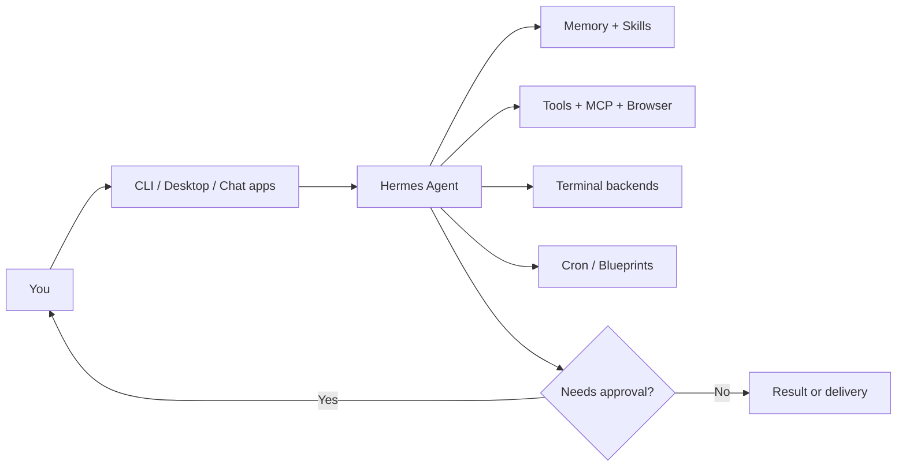

# Features (plain English)

  

All bullets below are sourced from the [official site](https://hermes-agent.nousresearch.com/), [README](https://github.com/NousResearch/hermes-agent), and [docs](https://hermes-agent.nousresearch.com/docs/).

## Big ideas

| Feature | What it means | Source |
|---------|---------------|--------|
| Lives everywhere | One agent across Telegram, Discord, Slack, WhatsApp, Signal, Email, CLI, and more | Official site, README |
| Persistent memory | Remembers projects, builds user context, searches past sessions (FTS5 + summarization). Honcho dialectic user modeling | README, [memory docs](https://hermes-agent.nousresearch.com/docs/user-guide/features/memory) |
| Skills learning loop | Creates skills from experience, improves them during use, compatible with [agentskills.io](https://agentskills.io) | README, [skills docs](https://hermes-agent.nousresearch.com/docs/user-guide/features/skills) |
| Scheduled automation | Natural-language cron jobs with delivery to messaging platforms | [cron docs](https://hermes-agent.nousresearch.com/docs/user-guide/features/cron) |
| Subagents | Isolated workers with their own conversations and terminals; Python RPC scripts for pipelines | README, official site |
| Web and media tools | Web search, browser automation, vision, image generation, text-to-speech, multi-model reasoning | Official site |
| Sandbox backends | Local, Docker, SSH, Singularity/Apptainer, Modal, Daytona, Vercel Sandbox (plugin backends exist too) | README, official site |
| MCP | Connect Model Context Protocol servers; curated picker via `hermes mcp` | [MCP docs](https://hermes-agent.nousresearch.com/docs/user-guide/features/mcp) |
| Tool Gateway | Nous Portal can route search, images, speech, cloud browser under one sub | [Tool Gateway](https://hermes-agent.nousresearch.com/docs/user-guide/features/tool-gateway) |
| Security controls | Command approval, DM pairing, container isolation | [security docs](https://hermes-agent.nousresearch.com/docs/user-guide/security) |

## CLI vs messaging (shared slash commands)

From the official README / community mirror of the same table on [hermesagents.net](https://hermesagents.net/):

| Action | CLI | Messaging gateway |
|--------|-----|-------------------|
| Start chatting | `hermes` | `hermes gateway setup` then message the bot |
| New conversation | `/new` or `/reset` | same |
| Change model | `/model` | same |
| Personality | `/personality` | same |
| Retry / undo | `/retry`, `/undo` | same |
| Compress / usage | `/compress`, `/usage` | same |
| Skills | `/skills` | platform skill commands |
| Interrupt | Ctrl+C or new message | `/stop` or new message |

Full command list: [CLI reference](https://hermes-agent.nousresearch.com/docs/reference/cli-commands).

## Pricing snapshot (Nous Portal)

Hermes Agent itself is MIT and free. Optional Nous Portal tiers (Free, Plus $20/mo, Super $100/mo, Ultra $200/mo) add usage, hosted tools, and cloud hosting sizes. Source: [official site pricing table](https://hermes-agent.nousresearch.com/). Always re-check the live page before buying.

## Diagram: how pieces connect

---

| | |
|:---|---:|
| [Install](install.md) ← | [Skills](skills.md) → |

