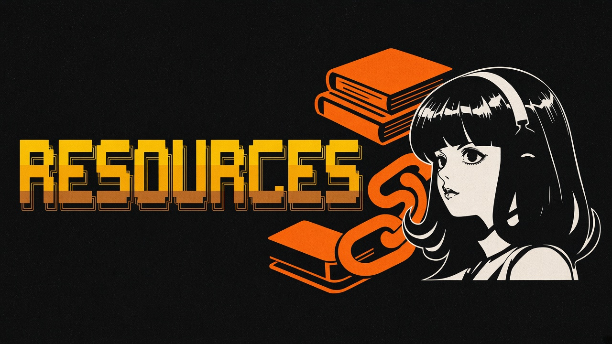

# Curated resources

  

## Official

| Resource | Link |
|----------|------|
| Product | https://hermes-agent.nousresearch.com/ |
| Docs | https://hermes-agent.nousresearch.com/docs/ |
| GitHub | https://github.com/NousResearch/hermes-agent |
| Portal | https://portal.nousresearch.com |
| Discord | https://discord.gg/NousResearch |
| Skills standard | https://agentskills.io |
| Nous Research | https://nousresearch.com |
| Self-evolution | https://github.com/NousResearch/hermes-agent-self-evolution |
| Autonovel | https://github.com/NousResearch/autonovel |
| Paperclip adapter | https://github.com/NousResearch/hermes-paperclip-adapter |

## Community indexes and guides

| Resource | Link |
|----------|------|
| This style of directory (0xNyk) | https://github.com/0xNyk/awesome-hermes-agent |
| frankxai agents index | https://github.com/frankxai/awesome-hermes-agent |
| frankxai skills companion | https://github.com/frankxai/awesome-hermes-agent-skills |
| 0xarkstar list | https://github.com/0xarkstar/awesome-hermes-agent |
| Community map | https://get-hermes.ai/community/ |
| Skills showcase | https://getclawcloud.com/skills |
| AgentSkillsHub Hermes filter | https://agentskillshub.top/?search=Hermes&tab=explore&min_stars=1000 |
| Ecosystem mirror / explainers | https://hermesagents.net/ |
| Medium skills-as-code guide | https://medium.com/@techlatest.net/git-for-agent-memory-why-you-should-treat-hermes-skills-like-code-61b03ed6f6b1 (browser OK; some bots get 403) |
| Orange book (Chinese) | https://github.com/alchaincyf/hermes-agent-orange-book |

## Popular projects snapshot

See the big tables in [skills.md](skills.md) (1000+ stars, fetched 2026-11-04 Asia/Dhaka).

---

| | |
|:---|---:|
| [FAQ](faq.md) ← | [Deployments](deployments.md) → |

