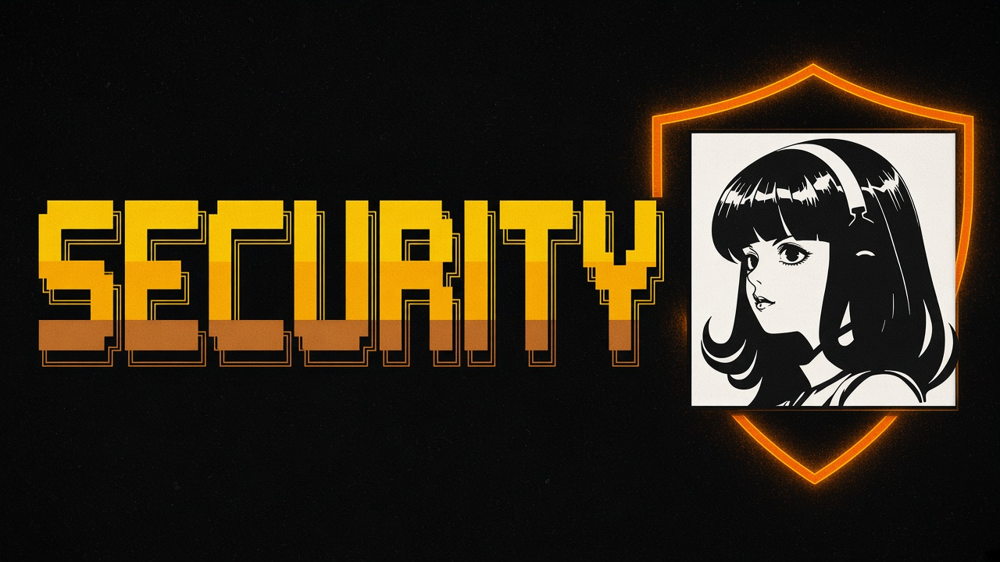

# Security and privacy habits

  

Official guide: [Security](https://hermes-agent.nousresearch.com/docs/user-guide/security).

## Beginner checklist

- [ ] Keep command approval on until you understand a workflow
- [ ] Use DM pairing / allowlists on messaging gateways
- [ ] Prefer Docker/SSH/Modal backends for untrusted skills
- [ ] Never paste API keys into public issues or skills you publish
- [ ] Review `SKILL.md` and scripts before enabling community skills
- [ ] Consider [NVIDIA/SkillSpector](https://github.com/NVIDIA/SkillSpector) for skill scans
- [ ] Use password-manager secret sources when available (`op://`, Bitwarden Secrets Manager per release notes mirrored on community sites; confirm in your version's docs)

## Skills Hub install scanning

Official Skills Hub / Desktop install flow runs a security scan and action log before a skill is installed from a hub card (`hermes://skill/install?...`). Source: [skills docs](https://hermes-agent.nousresearch.com/docs/user-guide/features/skills). Still review the skill yourself.

## Secrets

Prefer environment / secret managers over plaintext when you can. Official env reference: [environment variables](https://hermes-agent.nousresearch.com/docs/reference/environment-variables).

This awesome list will never ask for cookies, tokens, or private keys.

---

| | |
|:---|---:|
| [Troubleshooting](troubleshooting.md) ← | [Learning path](learning-path.md) → |

