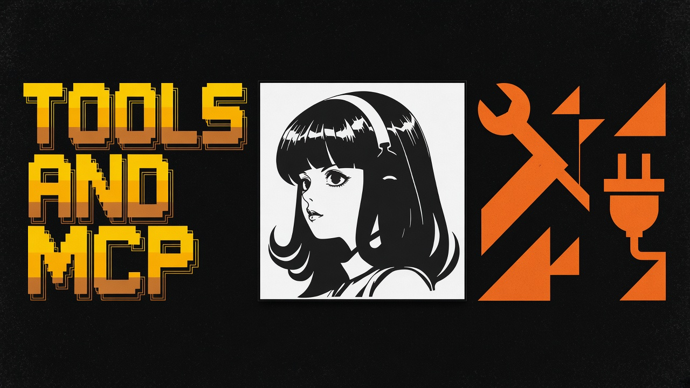

<a id="top"></a>
# Tools, MCP, and the Tool Gateway

<p align="center">
  
</p>

## Built-in tools

Hermes ships a large toolset (web search, browser automation, vision, image generation, voice, terminal backends, and more). Configure with:

```bash
hermes tools
```

Official docs: [Tools and toolsets](https://hermes-agent.nousresearch.com/docs/user-guide/features/tools).

## MCP

Connect any Model Context Protocol server for extra capabilities. Newer Hermes versions include a curated interactive catalog:

```bash
hermes mcp
```

Official docs: [MCP integration](https://hermes-agent.nousresearch.com/docs/user-guide/features/mcp).

## Nous Tool Gateway

With Nous Portal you can get hosted web search, image generation, text-to-speech, and cloud browser without juggling many vendor keys:

```bash
hermes setup --portal
hermes portal info
```

Docs: [Tool Gateway](https://hermes-agent.nousresearch.com/docs/user-guide/features/tool-gateway).

## Terminal backends (sandboxing)

Documented backends include local, Docker, SSH, Modal, Daytona, Vercel Sandbox, plus plugin backends such as Singularity/Apptainer. Daytona and Modal can hibernate when idle. Sources: [README](https://github.com/NousResearch/hermes-agent), [official site](https://hermes-agent.nousresearch.com/).

## Related community tooling

| Project | Stars (2026-11-04 Asia/Dhaka) |
|---------|-------------------------------|
| [avifenesh/computer-use-linux](https://github.com/avifenesh/computer-use-linux) | 797 |
| [NVIDIA/SkillSpector](https://github.com/NVIDIA/SkillSpector) | 24287 |
| [builderz-labs/mission-control](https://github.com/builderz-labs/mission-control) | 6442 |

---

| | |
|:---|---:|
| [Memory](memory.md) ← | [Workflows](workflows.md) → |

