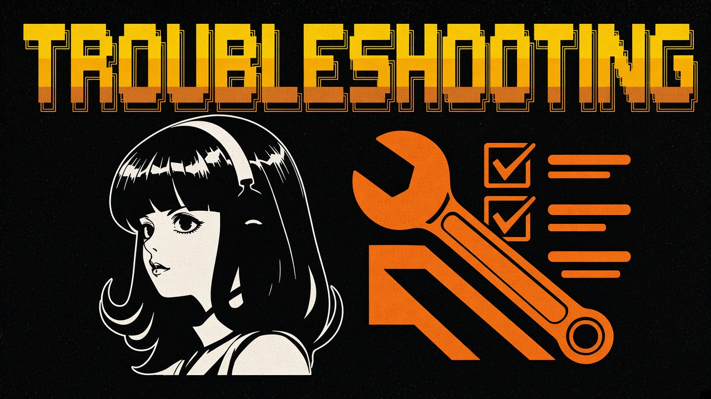

<a id="top"></a>
# Troubleshooting

<p align="center">
  
</p>

Start here:

```bash
hermes doctor
hermes update
```

| Symptom | Try this | Source |
|---------|----------|--------|
| `hermes: command not found` | `source ~/.bashrc` or `~/.zshrc`, or re-run installer | README, Medium guide |
| Provider / model errors | `hermes model` or `hermes setup --portal` | README |
| Antivirus quarantines `uv.exe` on Windows | Follow README attestation + whitelist of `%LOCALAPPDATA%\hermes\bin` | README |
| Browser tools heavy on small VPS | Install with `--skip-browser` | README / Medium guide |
| Skills not visible | Confirm `SKILL.md` under `~/.hermes/skills/<name>/`, restart session | skills docs + community guides |
| Gateway not receiving DMs | Re-check pairing/allowlists; run `hermes doctor` | security + gateway docs |
| OpenClaw import incomplete | `hermes import-agent openclaw --dry-run` then import; compare cron/channels | migration docs |

Official issues: [github.com/NousResearch/hermes-agent/issues](https://github.com/NousResearch/hermes-agent/issues). Discord: [discord.gg/NousResearch](https://discord.gg/NousResearch).

---

| | |
|:---|---:|
| [Limits](limits.md) ← | [Security](security.md) → |

