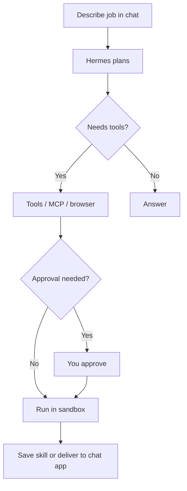

<a id="top"></a>
# Workflows (copy these patterns)

<p align="center">
  
</p>

These workflows use only documented Hermes capabilities. Adapt the words to your project.

## 1) Morning briefing on Telegram

1. Install and run `hermes setup` (or Desktop).
2. Configure the gateway: `hermes gateway setup` then `hermes gateway start`.
3. Ask Hermes in natural language to schedule a daily morning briefing (cron). Source: [cron docs](https://hermes-agent.nousresearch.com/docs/user-guide/features/cron).
4. Keep DM pairing / allowlists on until you trust the exposure. Source: [security](https://hermes-agent.nousresearch.com/docs/user-guide/security).

## 2) Research → skill → reuse

1. Chat in `hermes` and complete a multi-step research task.
2. Ask Hermes to save the method as a skill (or use `/learn` where available per release notes mirrored on community sites).
3. Confirm the skill appears under your skills folder / `/skills`.
4. Reuse it next session. Source: [skills docs](https://hermes-agent.nousresearch.com/docs/user-guide/features/skills).

## 3) Parallel subagents for a big chore

1. Describe the parent goal.
2. Ask Hermes to spawn isolated subagents for independent workstreams.
3. Review results before any send/deploy step. Source: [README](https://github.com/NousResearch/hermes-agent).

## 4) Migrate from OpenClaw safely

```bash
hermes plugins install agent-importers
hermes import-agent openclaw --dry-run
hermes import-agent openclaw
```

Only add `--migrate-secrets` if you truly want allowlisted keys moved. Source: [migration guide](https://hermes-agent.nousresearch.com/docs/guides/migrate-from-openclaw).

## 5) VPS always-on helper

1. Install with `--skip-browser` on a small VPS if you do not need local browser deps.
2. Use Docker/SSH backend for risky commands.
3. Attach Telegram or Discord gateway.
4. Add cron for backups/reports.



---

| | |
|:---|---:|
| [Tools and MCP](tools-mcp.md) ← | [Comparisons](comparisons.md) → |

